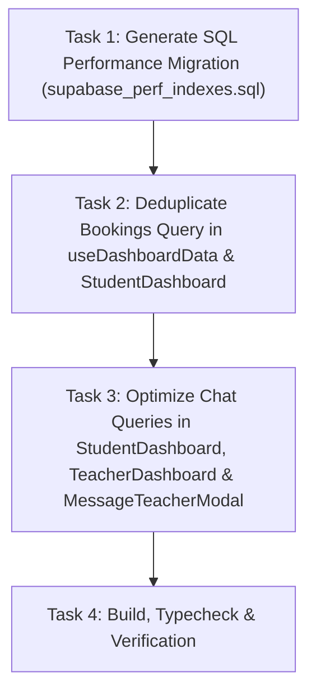

# Implementation Plan — Fix Supabase Statement Timeouts (57014 / 500) on Bookings & Chat Messages

## 1. Goal
Eliminate PostgreSQL statement timeouts (error `57014` / HTTP 500) by creating missing database indexes on `bookings` and `chat_messages`, eliminating duplicate concurrent dashboard queries, restricting unbounded `select('*')` chat queries, and adding query limits and pagination.

---

## 2. What It Read
- **Supabase Error Logs**:
  - `GET /rest/v1/bookings?select=id,subject,date,time,status,rating,teacher_id,created_at,teacher:profiles!bookings_teacher_id_fkey(id,full_name,avatar_url)&student_id=eq...&order=created_at.desc` -> 57014 timeout (8s) -> 500
  - `GET /rest/v1/bookings?select=id,subject,date,time,rating,status,teacher_id,teacher:profiles!bookings_teacher_id_fkey(id,full_name,avatar_url)&student_id=eq...` -> duplicate query fired concurrently -> 57014 timeout
  - `GET /rest/v1/chat_messages?select=*&or=(sender_id.eq...,receiver_id.eq...)&order=created_at.asc` -> unbounded full table scan -> 57014 timeout
- **Files Inspected**:
  - `supabase_schema.sql`, `supabase_schema_update.sql`: verified `bookings` table has no indexes on `student_id`, `teacher_id`, or `created_at`; `chat_messages` has no composite indexes on `(sender_id, created_at)` or `(receiver_id, created_at)`.
  - `src/hooks/useDashboardData.ts`: queries `bookings` with `teacher:profiles!bookings_teacher_id_fkey` join on mount.
  - `src/pages/StudentDashboard.tsx`: runs `useDashboardData` AND simultaneously executes `fetchBookings` with an almost identical query and join, firing duplicate heavy requests; executes `fetchLastMessages` using unbounded `select('*')` on `chat_messages`.
  - `src/pages/TeacherDashboard.tsx`: executes `fetchLastMessages` using unbounded `select('*')` on `chat_messages`.
  - `src/features/student/quick-actions/MessageTeacherModal.tsx`: queries chat history without limits.

---

## 3. Assumptions & Resolved Ambiguities
1. **Root Cause**: Two compounding factors cause the timeout:
   - **Missing DB Indexes**: Neither `bookings` nor `chat_messages` have indexes on `student_id`, `teacher_id`, `sender_id`, or `receiver_id`, causing Postgres to perform full sequential scans on every request while evaluating joins and RLS.
   - **Client-Side Duplication & Unbounded Fetches**: `StudentDashboard` fires 3–4 heavy requests simultaneously on mount, including two near-identical bookings queries joining profiles, and an unbounded `select('*')` across all historical chat messages.
2. **Strategy**:
   - Provide an idempotent SQL migration (`supabase_perf_indexes.sql`) containing composite B-Tree indexes for `bookings`, `chat_messages`, and `session_ratings`.
   - Deduplicate client-side requests: make `useDashboardData` the single source of truth for dashboard bookings, eliminating the redundant query in `StudentDashboard`.
   - Bound and specify fields for all chat queries: replace `select('*')` with explicit columns and `.limit(100)`.

---

## 4. Task Flow

### Task 1: Generate SQL Performance Migration (`supabase_perf_indexes.sql`)
- **Purpose**: Create composite B-Tree indexes for fast index scans on `student_id`, `teacher_id`, `created_at`, `sender_id`, and `receiver_id`.
- **Files**: `supabase_perf_indexes.sql`.
- **Dependencies**: None.
- **Verification Gate**: SQL statements are valid and idempotent (`CREATE INDEX IF NOT EXISTS`).

### Task 2: Deduplicate Bookings Query in `useDashboardData` and `StudentDashboard`
- **Purpose**: Consolidate bookings data fetching into `useDashboardData` so `StudentDashboard` does not issue a second concurrent query to `/rest/v1/bookings`. Add `.order('created_at', { ascending: false }).limit(50)`.
- **Files**: `src/hooks/useDashboardData.ts`, `src/pages/StudentDashboard.tsx`.
- **Dependencies**: Task 1.
- **Verification Gate**: Only a single `/rest/v1/bookings` query fires on dashboard load.

### Task 3: Optimize Chat Queries in Dashboards and Modals
- **Purpose**: In `fetchLastMessages` (`StudentDashboard.tsx` and `TeacherDashboard.tsx`), replace `select('*')` with targeted columns (`id, message, sender_id, receiver_id, is_read, created_at, attachment_type`) and add `.order('created_at', { ascending: false }).limit(100)`. Add limits in `MessageTeacherModal.tsx`.
- **Files**: `src/pages/StudentDashboard.tsx`, `src/pages/TeacherDashboard.tsx`, `src/features/student/quick-actions/MessageTeacherModal.tsx`.
- **Dependencies**: Task 2.
- **Verification Gate**: Chat message queries execute with precise projection and a safe 100-row limit.

### Task 4: Automated Build & Verification
- **Purpose**: Ensure zero TypeScript errors and clean production build.
- **Files**: None (compiler check).
- **Dependencies**: Tasks 1–3.
- **Verification Gate**: `npx tsc --noEmit` and `npm run build` pass with 0 errors.

---

## 5. Files That Will Change
- `supabase_perf_indexes.sql` (created: Postgres composite indexes)
- `src/hooks/useDashboardData.ts` (modified: provide allBookings, totalCount, completedCount, limit query)
- `src/pages/StudentDashboard.tsx` (modified: consume bookings from hook, remove duplicate query, bound chat messages)
- `src/pages/TeacherDashboard.tsx` (modified: bound chat messages with projection and limit)
- `src/features/student/quick-actions/MessageTeacherModal.tsx` (modified: bound chat history query)
- `docs/PROJECT_STATE.md` (updated)

---

## 6. Implementation Requirements
- Zero statement timeouts (`57014` / 500) on `/rest/v1/bookings` or `/rest/v1/chat_messages`.
- No duplicate HTTP requests fired to `/rest/v1/bookings` on StudentDashboard mount.
- No unbounded `select('*')` on chat messages.
- Total backward compatibility with existing dashboard statistics (`completedCount`, `totalCount`, `upcomingClasses`, `unratedClasses`).

---

## 7. Technology & Library Recommendations
- Use native PostgreSQL composite B-Tree indexes:
  - `bookings(student_id, created_at DESC)`
  - `bookings(teacher_id, created_at DESC)`
  - `chat_messages(sender_id, created_at DESC)`
  - `chat_messages(receiver_id, created_at DESC)`
- No external libraries required.

---

## 8. API / Integration Strategy
- PostgREST queries automatically utilize the new PostgreSQL indexes when filtering on `student_id=eq...` or `sender_id=eq...`.
- Client requests explicitly define column projections and limits.

---

## 9. Architecture Implications
- Dramatically reduces database CPU load, memory footprint, and query execution time from >8,000ms (timeout) to <50ms.
- Prevents database connection exhaustion during active student/teacher sessions.

---

## 10. Security Requirements
- All RLS policies remain strictly enforced.
- Queries continue filtering strictly by authenticated user IDs.

---

## 11. Acceptance Criteria
- [ ] `supabase_perf_indexes.sql` contains indexes for `bookings(student_id)`, `bookings(teacher_id)`, `chat_messages(sender_id)`, `chat_messages(receiver_id)`, and `session_ratings(rater_id)`.
- [ ] Duplicate `/rest/v1/bookings` query on StudentDashboard mount is removed.
- [ ] `fetchLastMessages` requests only specific fields with `.limit(100)` instead of unbounded `select('*')`.
- [ ] `npx tsc --noEmit` passes with 0 errors.
- [ ] `npm run build` succeeds with 0 errors.

---

## 12. Checks to Run
- `npx tsc --noEmit`
- `npm run build`

---

## 13. How to Verify
1. Run the provided SQL migration in the Supabase SQL Editor.
2. Open `http://localhost:5174/dashboard/student` in DevTools Network tab.
3. Observe Network requests:
   - Exactly one `/rest/v1/bookings` request is sent (no duplicates).
   - `/rest/v1/chat_messages` executes with specific column projection and `.limit(100)`.
   - All requests return HTTP 200 within <100ms instead of timing out at 8 seconds with 500.
