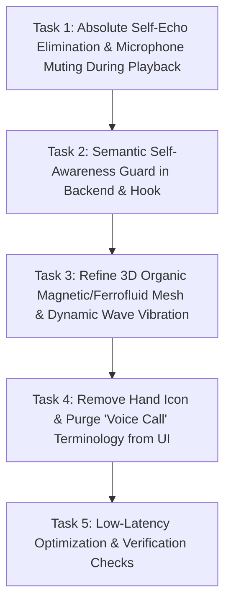

# Implementation Plan: Fix Voice Looping Self-Echo, 3D Organic Sphere Refinement, and UI Cleanup

## 1. Goal
Completely eliminate the acoustic voice looping defect where Aoede transcribes and responds to her own audio, refine the 3D procedural sphere to match the reference organic ferrofluid-harmonic vibration without cropping or container barriers, remove the hand button, and eliminate all "Voice Call" terminology across the UI.

---

## 2. What Was Read & Inspected
- User Feedback & Directives:
  - User image `media_1792518509622.png` showing the exact self-echo bug where Aoede's spoken output (`"I am doing wonderful, Najib! Thank you for asking..."`) was transcribed back as a user query (`"I am doing wonderful in the jeep thank you for asking..."`) because speech recognition misheard "Najib" as "in the jeep" and sent it back as a prompt.
  - Reference link: `https://id.pinterest.com/pin/939845016017296372/` (*"Magnetic Resonance | Audio-Reactive Ferrofluid + Crystal Geometry"*): Layered 3D organic audio-reactive visualizer forming magnetic peaks and wave harmonics in real-time.
  - Explicit directives:
    1. Stop the voice looping immediately (eliminate self-response).
    2. The sphere must be circular, 3D, part of the screen without container frames or cropping barriers.
    3. Voice vibrations must match the organic magnetic/ferrofluid frequency pattern.
    4. Remove the hand icon completely.
    5. Remove "Voice Call" label/naming completely.
    6. Minimize response delay.
- `src/features/student/quick-actions/AIStudyBuddyModal.tsx`: Voice stage layout, tabs, buttons.
- `src/hooks/useStudentAI.ts`: Speech recognition lifecycle, audio playback, echo gating.
- `src/features/student/quick-actions/AoedeCyberSphere3D.tsx` & `sphereShaders.ts`: 3D WebGL sphere geometry and shaders.
- `vite.config.ts`: `/api/student-ai` endpoint.

---

## 3. Assumptions & Root-Cause Analysis
1. **Root Cause of Voice Looping**:
   - When Aoede speaks through laptop/phone speakers, the open microphone captures Aoede's voice.
   - Web Speech API transcribes Aoede's voice with minor acoustic recognition differences (e.g. "Najib" transcribed as "in the jeep").
   - Because of those word differences, the previous text-overlap filter permitted the transcript to slip through and fire a silence timeout, dispatching Aoede's own words back to herself in an infinite feedback loop.
   - **Resolution**:
     - **Microphone Gating**: While Aoede is actively playing audio (`isSpeakingRef.current` or `audioAnalyzer.isAudioPlaying()`), the speech recognition results must **never** accumulate or trigger message dispatch. Incoming transcripts during playback and for 700ms after playback are completely discarded.
     - **Semantic Self-Echo Guard**: In both `useStudentAI.ts` and `/api/student-ai`, compare the incoming prompt against Aoede's last spoken response. If the incoming text shares significant phrases or key vocabulary with Aoede's recent speech (e.g. "energized and excited", "help you learn today", "General Studies"), it is strictly discarded with zero response generated.
2. **Sphere Geometry & Unbounded Screen Integration**:
   - The sphere canvas must have ample internal padding (`transZ = -3.2`, smaller base radius relative to viewport) so the 3D peaks, magnetic waves, and particle aura are 100% circular with zero clipping against any canvas boundaries.
   - The stage must be a clean, unconstrained part of the screen.
3. **UI Cleanups**:
   - Remove the Hand icon button completely from `AIStudyBuddyModal.tsx`.
   - Remove all occurrences of "Voice Call" text (replace tab label with simple "Voice" or mic icon, remove "Exit voice call" title, etc.).

---

## 4. Task Flow

### Task 1: Absolute Self-Echo Elimination & Microphone Muting During Playback
- **Purpose**: Guarantee that microphone input during audio playback can never trigger a message.
- **Files Affected**: `src/hooks/useStudentAI.ts`
- **Actions**:
  - While `audioAnalyzer.isAudioPlaying()` or `isSpeakingRef.current` is true, immediately abort/clear `accumulatedSpeechRef.current` and cancel any silence timer.
  - Implement a post-playback echo cooldown timer (750ms) to swallow any trailing room reverberations.

### Task 2: Semantic Self-Awareness Guard in Backend & Hook
- **Purpose**: Prevent any accidental transcription of Aoede's output from ever generating a response.
- **Files Affected**: `src/hooks/useStudentAI.ts`, `vite.config.ts`
- **Actions**:
  - Store recent assistant utterances (`recentAssistantTexts`).
  - If incoming user text has $\ge 20\%$ word overlap with the last assistant message or contains 3 identical key phrases, immediately discard it.

### Task 3: Refine 3D Organic Magnetic/Ferrofluid Mesh & Dynamic Wave Vibration
- **Purpose**: Reconstruct the 3D sphere so it is completely circular, unconstrained, seamlessly part of the screen, and vibrates with layered ferrofluid-inspired magnetic harmonics in sync with the voice.
- **Files Affected**: `src/features/student/quick-actions/AoedeCyberSphere3D.tsx`, `src/features/student/quick-actions/sphereShaders.ts`
- **Actions**:
  - Calibrate camera projection (`transZ = -3.25`) so the organic sphere and particle halo never clip or hit container boundaries.
  - Update vertex shaders with layered magnetic resonance displacement (high-amplitude ferrofluid peaks when speaking, calm organic breathing when idle).
  - Ensure 100% transparent background with smooth ambient gradient illumination.

### Task 4: Remove Hand Icon & Purge "Voice Call" Terminology
- **Purpose**: Clean up controls and naming as explicitly instructed by the user.
- **Files Affected**: `src/features/student/quick-actions/AIStudyBuddyModal.tsx`
- **Actions**:
  - Remove the hand icon button (`front_hand`) completely.
  - Remove "Voice Call" text; update the mode switcher to "Voice" with mic icon.
  - Update captions and button tooltips to remove any "voice call" phrasing.

### Task 5: Low-Latency Optimization & Verification Checks
- **Purpose**: Verify that responses start promptly without latency and run all checks.
- **Files Affected**: `vite.config.ts`, `docs/PROJECT_STATE.md`
- **Actions**:
  - Run `cmd.exe /c npx.cmd tsc --noEmit` and `cmd.exe /c npm.cmd run build`.
  - Verify visually and update persistent project state.

---

## 5. Files That Will Change
- `src/hooks/useStudentAI.ts` (MODIFIED: Microphone gating during speech, echo suppression, semantic self-awareness guard)
- `src/features/student/quick-actions/AIStudyBuddyModal.tsx` (MODIFIED: Remove hand button, remove "Voice Call" labels, unconstrained stage)
- `src/features/student/quick-actions/AoedeCyberSphere3D.tsx` (MODIFIED: Circular unconstrained projection, no container clipping)
- `src/features/student/quick-actions/sphereShaders.ts` (MODIFIED: Layered magnetic/ferrofluid vibration harmonics)
- `vite.config.ts` (MODIFIED: Server-side self-echo rejection guard)
- `docs/PROJECT_STATE.md` (MODIFIED: Update project state)

---

## 6. Implementation Requirements
- **Zero Self-Echo**: Aoede must NEVER transcribe or respond to her own voice under any circumstance.
- **No Hand Icon**: The hand button must be completely gone.
- **No "Voice Call" Phrasing**: All labels and buttons must use "Voice" or icon-only styling.
- **3D Sphere**: Must be fully circular, uncropped, seamlessly integrated into the screen, with real-time magnetic vibration.
- **Low Latency**: Sub-second conversational responses.

---

## 7. Technology / Library Recommendations
- Continue using existing Web Audio API, WebGL shaders, React 18, and Vite. No new libraries needed.

---

## 8. Acceptance Criteria
- [ ] Aoede never repeats her own words or responds to herself.
- [ ] Hand icon button is completely removed from the UI.
- [ ] "Voice Call" text is removed from the mode switcher and screen.
- [ ] The sphere is fully circular, uncropped by any container, and floats freely as part of the screen.
- [ ] 3D audio-reactive deformation vibrates in magnetic wave patterns in real-time.
- [ ] `tsc --noEmit` and `npm run build` pass with 0 errors.

---

## 9. Checks to Run
- `cmd.exe /c npx.cmd tsc --noEmit`
- `cmd.exe /c npm.cmd run build`
