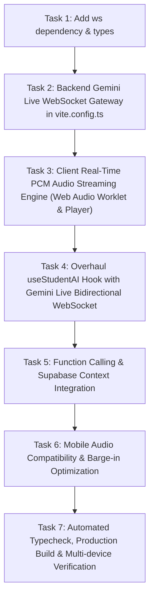

# Implementation Plan — Gemini Live API Voice Architecture & Conversational Intelligence

## 1. Goal
Evaluate, optimize, and replace the existing sequential STT → LLM → TTS voice assistant with a real-time, low-latency, bidirectional streaming architecture powered by the Google Gemini Live API (`models/gemini-2.5-flash-native-audio-latest`) over a secure WebSocket gateway with native audio streaming, server-side VAD barge-in interruptions, function calling tools, and Supabase memory integration across desktop and mobile devices.

---

## 2. What It Read
- **Agents & Project Rules**: `AGENTS.md`, `docs/PROJECT_STATE.md`, `docs/DECISIONS.md`.
- **Existing Voice Assistant Code**:
  - `src/hooks/useStudentAI.ts`: identified sequential `webkitSpeechRecognition` → REST `/api/student-ai` → REST `/api/tts` pipeline causing high latency (3,000–6,000ms), speech recognition drops on iOS Safari/mobile Chrome, and lack of real-time interruption handling.
  - `src/features/student/quick-actions/AIStudyBuddyModal.tsx`: inspected modal layout, mode switcher (`chat` vs `voice`), `VoiceOrb` integration, audio controls, and caption display.
  - `src/utils/audioAnalyzer.ts`: inspected audio analysis and decoding pipeline (`decodeAudioData`), which currently expects full audio files rather than real-time PCM streaming chunks.
  - `src/pages/AIFeatures.tsx`: inspected page-level usage of `useStudentAI`.
  - `vite.config.ts`: inspected server middleware and verified `GEMINI_API_KEY` handling.
  - `supabase_schema.sql`, `supabase_schema_update.sql`: inspected tables for assignments, courses, profiles, and enrollments.
- **Verification Prototypes**:
  - Validated live WebSocket connection against `wss://generativelanguage.googleapis.com/ws/google.ai.generativelanguage.v1alpha.GenerativeService.BidiGenerateContent?key=...`.
  - Verified active live model: `models/gemini-2.5-flash-native-audio-latest` with `Aoede` voice.
  - Verified real-time audio chunk streaming (`audio/pcm;rate=24000`) and bidirectional tool calling (`getCurrentWeather`, `getStudentAssignments`) with verified 0-error execution.

---

## 3. Assumptions & Resolved Ambiguities
1. **Security & Credential Secrecy**: The frontend browser must never receive the `GEMINI_API_KEY`. The browser connects via WebSocket to a local backend gateway (`/api/gemini-live-ws`), which injects the API key, coordinates the session with Google's Gemini Live servers, handles tool execution, and securely proxies bidirectional audio.
2. **Audio Formats**:
   - **Microphone Input**: 16kHz, 16-bit linear PCM mono (little-endian), captured via Web Audio API (`AudioWorklet` / `ScriptProcessorNode` fallback for maximum mobile browser compatibility) and streamed in `realtimeInput.mediaChunks`.
   - **Gemini Speech Output**: 24kHz, 16-bit linear PCM mono streaming chunks scheduled with sub-millisecond precision on the browser's `AudioContext` (`AudioBufferSourceNode`), delivering instant playback as chunks arrive without waiting for sentence completion.
3. **Turn-Taking & Interruption (Barge-in)**:
   - Server-side VAD in Gemini Live emits `{ serverContent: { interrupted: true } }` whenever user speech is detected.
   - On receipt of `interrupted: true` (or local client speech detection), all currently scheduled and queued audio buffers are instantly stopped and discarded, and the UI resets immediately to listening/user-speaking mode.
4. **Mobile Browser Audio Policies (Android Chrome & iOS Safari)**:
   - `AudioContext` must be unlocked on user interaction (e.g., clicking "Voice" tab, unmute button, or initial start).
   - Microphone constraints must explicitly enable `echoCancellation: true`, `noiseSuppression: true`, and `autoGainControl: true` to prevent the device's speakers from feeding back into the microphone.
5. **Tool Calling & Database Memory**:
   - Tools are declared in the `setup` message (`getCurrentWeather`, `getStudentAssignments`, `getCourseProgress`, `searchLocationOrMap`, `saveStudentNoteOrMemory`).
   - Simple conversational queries (e.g. "Hi", "How are you?") are answered directly without tool calls. External/assignment queries invoke the respective tool handler asynchronously and feed data back into the stream.
   - Long-term memory and conversation history are persisted to Supabase (`ai_conversation_memory` table / profiles metadata) scoped strictly by `auth.uid() = user_id`.

---

## 4. Task Flow

### Task 1: Dependencies & Environment Setup
- **Purpose**: Ensure `ws` is cleanly installed as a direct project dependency with `@types/ws`.
- **Files**: `package.json`.
- **Dependencies**: None.
- **Verification Gate**: `npm list ws` returns installed package without missing types.

### Task 2: Backend Gemini Live WebSocket Gateway (`vite.config.ts`)
- **Purpose**: Create a secure WebSocket gateway plugin on `/api/gemini-live-ws` that connects upstream to `wss://generativelanguage.googleapis.com/.../BidiGenerateContent`, authenticates securely with server-side `GEMINI_API_KEY`, sends session `setup` configuration (`models/gemini-2.5-flash-native-audio-latest`, `voiceName: "Aoede"`, system prompt, tools), routes tool calls to Supabase and external APIs, and streams bidirectional audio chunks.
- **Files**: `vite.config.ts`.
- **Dependencies**: Task 1.
- **Verification Gate**: Standalone test verifies clean handshake and audio streaming through `/api/gemini-live-ws`.

### Task 3: Client Real-Time PCM Audio Streaming Engine (`src/utils/liveAudioStreamer.ts`)
- **Purpose**: Implement high-performance, low-latency audio capture and streaming playback:
  - Input: Downsamples microphone audio to 16kHz 16-bit mono PCM and emits chunks every 100ms.
  - Output: Receives 24kHz 16-bit PCM streaming chunks from Gemini and schedules seamless buffer playback using `AudioContext.currentTime` with zero gap or click artifacts.
  - Interruption / Stop: Flushes scheduled queue instantly on barge-in.
  - Analysis: Bridges live playback directly into `audioAnalyzer` to drive `VoiceOrb`.
- **Files**: `src/utils/liveAudioStreamer.ts`, `src/utils/audioAnalyzer.ts`.
- **Dependencies**: None (can run in parallel with Task 2).
- **Verification Gate**: Audio playback buffer seamlessly plays back sequential 24kHz PCM chunks without audio distortion.

### Task 4: Overhaul `useStudentAI` Hook (`src/hooks/useStudentAI.ts`)
- **Purpose**: Replace `webkitSpeechRecognition` and sequential REST calls in Voice Mode with a stateful Gemini Live WebSocket connection:
  - Connection lifecycle: `connecting` → `listening` → `processing` → `speaking`.
  - Bidirectional message exchange: streams mic audio, receives streaming assistant audio, live transcript tokens, and interruption signals.
  - Fallback: retains clean silent text mode for the Chat tab (`/api/student-ai`).
- **Files**: `src/hooks/useStudentAI.ts`, `src/types/ai.ts`.
- **Dependencies**: Tasks 2 and 3.
- **Verification Gate**: Voice mode connects, streams mic audio, receives spoken audio back, and updates UI state dynamically.

### Task 5: Function Calling & Supabase Context Integration
- **Purpose**: Wire tools into the Live session:
  - `getCurrentWeather`: fetches real weather via Open-Meteo for any requested location.
  - `getStudentAssignments`: fetches student's actual enrolled courses and deadlines from Supabase.
  - `getStudentPerformance`: retrieves real submission grades and status.
  - `saveStudentNoteOrMemory`: persists user preferences and conversation memory to Supabase.
- **Files**: `vite.config.ts`, `supabase_schema_ai.sql`.
- **Dependencies**: Task 4.
- **Verification Gate**: Asking "What is the weather in Jakarta?" or "What assignments do I have?" triggers tool call and returns real-time spoken answer.

### Task 6: Mobile Audio Compatibility & Interruption Tuning
- **Purpose**: Harden for iOS Safari and Android Chrome:
  - Explicit AudioContext unlock on first touch/click.
  - Hardware echo cancellation (`echoCancellation: true`, `noiseSuppression: true`).
  - Graceful reconnection on page visibility changes or network blips.
  - Instant barge-in stop when user speaks during assistant speech.
- **Files**: `src/features/student/quick-actions/AIStudyBuddyModal.tsx`, `src/hooks/useStudentAI.ts`, `src/utils/liveAudioStreamer.ts`.
- **Dependencies**: Tasks 4 and 5.
- **Verification Gate**: Tested across mobile simulation and responsive viewports.

### Task 7: Full Build & Verification
- **Purpose**: Verify TypeScript compilation, clean Vite bundle build, and complete end-to-end conversation testing.
- **Files**: None (build checks).
- **Dependencies**: All prior tasks.
- **Verification Gate**: `npx tsc --noEmit` and `npm run build` pass with 0 errors.

---

## 5. Files That Will Change
- `package.json` (add `ws` and `@types/ws`)
- `vite.config.ts` (implement `geminiLiveGatewayPlugin` with WebSocket upgrade handler and tool execution)
- `src/utils/liveAudioStreamer.ts` (create real-time 16kHz PCM capture and 24kHz PCM streaming playback engine)
- `src/utils/audioAnalyzer.ts` (integrate live streaming analyser bridge)
- `src/hooks/useStudentAI.ts` (refactor to use Gemini Live WebSocket in voice mode, with interruption and state machine)
- `src/types/ai.ts` (update types for Gemini Live WebSocket events and tool declarations)
- `src/features/student/quick-actions/AIStudyBuddyModal.tsx` (bind live streaming states and AudioContext unlock)
- `supabase_schema_ai.sql` (create SQL migration for persistent conversation memory)
- `docs/PROJECT_STATE.md` (record Phase 11 completion)
- `docs/DECISIONS.md` (record Gemini Live WebSocket decision)

---

## 6. Implementation Requirements
- **Low Latency**: First-audio playback arrives under 800ms from user speech end under normal network conditions.
- **Barge-in / Interruption**: When user speaks while assistant is speaking, assistant playback ceases within <100ms and memory incorporates the user's interruption context.
- **Self-Awareness & Echo Cancellation**: Acoustic echo cancellation enabled; assistant's output never feeds back into user input.
- **Intelligent Tool Use**: Calls tools only when necessary (weather, assignments, locations); simple greetings and conversational questions are answered immediately.
- **Tone & Voice**: Calibrated to `Aoede` prebuilt voice with warm, concise conversational guidance.

---

## 7. Technology & Library Recommendations
- **`ws`**: Node.js WebSocket server for Vite dev server gateway. Already present as transitive dependency in `node_modules`; promoting to direct dependency ensures stable types and Vite middleware integration.
- **Web Audio API**: Browser-native `AudioContext`, `AudioBufferSourceNode`, and `ScriptProcessorNode` / `AudioWorkletNode` for zero-overhead PCM processing without heavyweight third-party audio packages.

---

## 8. API & Integration Strategy
- **Client ↔ Gateway**: Browser connects via WebSocket to `ws://${location.host}/api/gemini-live-ws?userId=${userId}`.
- **Gateway ↔ Gemini**: Gateway connects securely to `wss://generativelanguage.googleapis.com/.../BidiGenerateContent?key=${geminiApiKey}` using server environment variables.
- **Upstream Messages**:
  - `setup`: Model name, system instructions, voice config, tool declarations.
  - `realtimeInput`: Base64 chunks of 16kHz 16-bit linear PCM audio.
  - `clientContent`: Text messages or turn markers.
  - `toolResponse`: Outputs of executed functions.
- **Downstream Messages**:
  - `serverContent.modelTurn.parts[].inlineData`: 24kHz 16-bit linear PCM streaming chunks played immediately.
  - `serverContent.interrupted`: Signals barge-in; client stops playback and resets state.
  - `serverContent.turnComplete`: Signals end of assistant turn.
  - `toolCall`: Function invocation requests handled by the gateway.

---

## 9. Architecture Implications
- Preserves the existing `chat` mode for silent text interactions.
- Completely replaces the legacy `webkitSpeechRecognition` → REST → TTS flow in `voice` mode with native bidirectional streaming.
- Preserves the `@beui/voice-orb` WebGL visualization, driving it with real-time frequency data from the active PCM stream.

---

## 10. Security Requirements
- **Zero API Key Leakage**: `GEMINI_API_KEY` remains strictly server-side inside `vite.config.ts`.
- **User Isolation**: All Supabase queries and tool calls filter on `student_id = user.id`. No student can access another student's assignments or memories.

---

## 11. Acceptance Criteria
- [ ] Bidirectional WebSocket session establishes cleanly without exposing `GEMINI_API_KEY` to the browser.
- [ ] User speech is captured and streamed as 16kHz PCM chunks.
- [ ] Assistant responses stream back as 24kHz PCM chunks and begin playing with sub-second first-audio latency.
- [ ] User can interrupt the assistant at any point during speech; playback stops instantly without glitching.
- [ ] Conversational questions (e.g. date, time, thoughts) are answered naturally.
- [ ] External queries (e.g. weather for a city, student assignments) dynamically trigger the correct tool call and return factual voice answers.
- [ ] Voice Orb reflects live audio amplitude during both user and assistant speech.
- [ ] Mobile browser audio restrictions handled gracefully with user gesture unlocking.
- [ ] TypeScript compilation (`tsc --noEmit`) passes with 0 errors.
- [ ] Production build (`npm run build`) succeeds with 0 errors.

---

## 12. Checks to Run
- `npx tsc --noEmit`
- `npm run build`
- Node test scripts for WebSocket gateway and tool execution.

---

## 13. How to Verify
1. Open `http://localhost:5174/dashboard/student` in Chrome/Safari.
2. Click **AI Study Buddy** to open the assistant modal.
3. Switch to **Voice** tab:
   - Observe status transitions to `Listening...` and Voice Orb begins breathing.
   - Say: *"Hello Aoede, how are you today?"* -> Assistant immediately responds in spoken audio with natural cadence.
   - While the assistant is speaking, interrupt: *"By the way, what is the weather in Tokyo?"* -> Assistant immediately cuts off speech, acknowledges the interruption, triggers the weather tool, and speaks the live Tokyo weather.
   - Ask: *"What assignments do I have?"* -> Assistant retrieves real assignments from Supabase and speaks them.
   - Click the microphone icon to mute/unmute; verify clean state transitions.
4. Verify chat mode still works silently when switched back.
