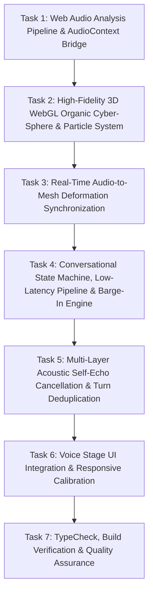

# Implementation Plan: AI Voice Assistant Visual Reconstruction, Real-Time Audio Synchronization, and Conversational Intelligence Optimization

## 1. Goal
Reconstruct the AI voice assistant's 3D visual sphere to faithfully reproduce the organic, dense wireframe geometry, cyan-to-magenta gradient, and luminous particle constellation from the reference design, while integrating a real-time Web Audio synchronization pipeline, low-latency conversational turn-taking, robust barge-in interruptions, and multi-layer acoustic self-echo prevention.

---

## 2. What Was Read & Inspected
- `AGENTS.md` and `.agents/AGENTS.md`: Mandatory workflows, approval protocols, and architecture boundaries.
- `docs/PROJECT_STATE.md`: Phase 1-6 development history, Aoede neural voice pipeline, audio settings, and verification status.
- `docs/DECISIONS.md`: Technology choices, Supabase auth, Stream/LiveKit boundaries, and design token rules.
- `package.json`: Existing dependencies (React 18, Vite 5, Tailwind CSS, Lucide React, Radix UI).
- `src/features/student/quick-actions/AoedeCyberSphere3D.tsx`: Existing 2D canvas wireframe sphere with static trigonometric sine wave oscillation and no audio analysis.
- `src/features/student/quick-actions/AIStudyBuddyModal.tsx`: Voice call modal stage, caption card, mic controls, and visual layout.
- `src/hooks/useStudentAI.ts`: Speech recognition lifecycle, audio playback (`new Audio()`), echo suppression logic, silence detection, and message dispatch.
- `src/pages/AIFeatures.tsx`: Standalone AI page consuming `useStudentAI`.
- `vite.config.ts`: `/api/student-ai` Socratic pedagogical reasoning engine and `/api/tts` Google Gemini neural voice synthesis (`gemini-3.8-flash-tts` / `Aoede`).
- User Reference Images:
  - Reference 1 (`media_1792516233993.png`): Target organic 3D wireframe cyber-sphere with deep wave folds, dense grid curvature, electric cyan-to-deep blue-to-violet-to-vibrant magenta gradient, illuminated ridges, and surrounding particle halo.
  - Reference 2 (`media_1792516240776.png`): Current sparse cage-like wireframe sphere within the white voice-call UI.

---

## 3. Assumptions & Resolved Ambiguities
1. **Background Treatment**: The black background in Reference 1 is not part of the requirement. The sphere must render with a 100% transparent canvas and blend cleanly into the clean white/light workspace of the voice call interface.
2. **Rendering Technology**: To avoid adding bulky third-party dependencies (~600KB Three.js bundle) while delivering true GPU-accelerated vertex deformation, line anti-aliasing, and 60-120 FPS performance across desktop and mobile browsers, the sphere will be implemented using a high-performance native WebGL pipeline with custom vertex and fragment shaders. If WebGL context creation fails on any legacy device, a smooth 2D canvas fallback will automatically take over.
3. **Voice Response Conciseness**: Natural human voice conversations require concise, direct responses (1-3 sentences) rather than essay-length paragraphs. We will optimize the system prompt and pedagogical engine for conversational voice brevity, significantly reducing TTS synthesis and audio transmission time.
4. **Microphone Echo Cancellation**: Browser-level `navigator.mediaDevices.getUserMedia` constraints (`echoCancellation: true`, `noiseSuppression: true`) will be combined with application-level acoustic text/phonetic comparison and cooldown timers to guarantee zero self-listening feedback loops.

---

## 4. Task Flow (Step-by-Step Dependencies)

### Task 1: Web Audio Analysis Pipeline & AudioContext Bridge
- **Purpose**: Create a Web Audio API analyzer that inspects the actual audio waveform played to the user in real time, calculating RMS volume and spectral energy across Bass (50-250 Hz), Mid (250-2000 Hz), and High (2000-8000 Hz) bands.
- **Dependencies**: None.
- **Files Affected**:
  - Create `src/utils/audioAnalyzer.ts` (Web Audio API manager, AnalyserNode setup, AudioBuffer decoding/playback, frequency/RMS feature extraction).
- **Risks**: Browser autoplay policies blocking AudioContext before user interaction.
- **Mitigation**: AudioContext will be initialized or resumed lazily on the first user interaction (e.g. entering voice mode or clicking).
- **Gate**: Frequency data and RMS energy values extract accurately from synthesized audio buffers with zero console warnings.

### Task 2: High-Fidelity 3D WebGL Organic Cyber-Sphere & Particle System
- **Purpose**: Reconstruct `AoedeCyberSphere3D.tsx` to match the exact visual characteristics of Reference Image 1.
  - Dense, organic, undulating 3D curvilinear mesh geometry (quad grid topology with high vertex density, e.g. 72x72 subdivisions, 0 pinched poles).
  - Multi-octave 3D Simplex/Perlin noise deformation generating the deep folds, soft peaks, and flowing sculptural contours.
  - Spatial gradient matching Reference 1: Electric Cyan (`#00f5ff`) and Deep Royal Blue (`#0044ff`) on the left to Violet/Purple (`#7928ca`) in the center to Radiant Neon Magenta (`#ff0080`) and Hot Pink on the right.
  - Ridge illumination and luminous edge highlights (Fresnel shading) that make peaks glow brightly while interior folds retain deep dimensionality.
  - Procedural orbiting particle halo: A spherical constellation of luminous dust particles floating around the perimeter, dynamically colored to match their spatial position.
  - Transparent canvas with ambient backlight glow that integrates into the existing white voice-call UI.
- **Dependencies**: None (can be developed with simulated uniforms, then bound to Task 1).
- **Files Affected**:
  - Modify `src/features/student/quick-actions/AoedeCyberSphere3D.tsx`.
  - Create `src/features/student/quick-actions/sphereShaders.ts` (GLSL vertex and fragment shaders for 3D deformation, lighting, line anti-aliasing, and particle rendering).
- **Risks**: WebGL context loss or high GPU fill-rate on low-end mobile devices.
- **Mitigation**: Adaptive DPR scaling (capped at 2.0 max) and clean WebGL context restoration handlers.
- **Gate**: Sphere renders with dense organic folds, accurate cyan-magenta gradient, illuminated ridges, and particle halo matching Reference 1.

### Task 3: Real-Time Audio-to-Mesh Deformation Synchronization
- **Purpose**: Connect the Web Audio analyzer metrics (`u_audioBass`, `u_audioMid`, `u_audioHigh`, `u_audioRMS`) to the 3D vertex shader in real time.
  - Low-frequency bass drives rhythmic volumetric expansions and deep sculptural lobe motion.
  - Mid frequencies drive organic wave propagation across the surface folds.
  - High frequencies drive micro-ripples and particle shimmer.
  - When speech pauses between words, the mesh deformation softens instantly and smoothly returns to calm idle breathing.
  - When speech stops, all audio-driven vibration ceases immediately.
- **Dependencies**: Task 1, Task 2.
- **Files Affected**:
  - `src/features/student/quick-actions/AoedeCyberSphere3D.tsx`
  - `src/hooks/useStudentAI.ts`
- **Risks**: Latency or jitter between audible sound and visual displacement.
- **Mitigation**: Audio analysis reads directly from the active Web Audio playback node on every `requestAnimationFrame`, with exponential smoothing (lerp) preventing harsh vertex snapping.
- **Gate**: Visual mesh deformation perfectly coincides with audible voice output; zero deformation during silence.

### Task 4: Conversational State Machine, Low-Latency Pipeline & Barge-In Engine
- **Purpose**: Upgrade the conversational engine for instant responses and natural voice interruptions.
  - Formal state model: `'idle' | 'listening' | 'processing' | 'speaking'`.
  - Reduce endpoint detection silence timeout to an adaptive 450-550ms for prompt turn-taking.
  - Voice-optimized prompt guidance in `/api/student-ai` to ensure warm, concise 1-3 sentence answers for voice interactions.
  - Instant barge-in: When user speaks while Aoede is talking, audio output halts immediately (< 10ms), pending network requests are aborted via `AbortController`, conversational `turnId` increments, and the sphere transitions to `listening`.
- **Dependencies**: Task 1.
- **Files Affected**:
  - `src/hooks/useStudentAI.ts`
  - `src/features/student/quick-actions/AIStudyBuddyModal.tsx`
  - `vite.config.ts`
- **Risks**: Stale asynchronous fetch callbacks re-starting audio after an interruption.
- **Mitigation**: `turnId` verification and `AbortController.abort()` on any new user speech event.
- **Gate**: User speaking during Aoede audio instantly cuts off sound and transitions state to listening.

### Task 5: Multi-Layer Acoustic Self-Echo Cancellation & Turn Deduplication
- **Purpose**: Prevent Aoede from hearing her own voice through laptop or mobile speakers.
  - Layer 1: Hardware/browser acoustic echo cancellation (`navigator.mediaDevices.getUserMedia` with `echoCancellation: true, noiseSuppression: true`).
  - Layer 2: Audio playback state tracking.
  - Layer 3: Fuzzy sequence comparison (normalized n-gram and word similarity) against Aoede's recent speech output.
  - Layer 4: Post-playback echo cooldown buffer (550ms).
  - Layer 5: Request deduplication preventing duplicate queries from firing within 3 seconds.
- **Dependencies**: Task 4.
- **Files Affected**:
  - `src/hooks/useStudentAI.ts`
- **Risks**: Over-filtering preventing real user words if the user repeats a word Aoede just said.
- **Mitigation**: Multi-word sequence matching and speech duration thresholding; real user interruptions are allowed when distinct from the synthesized text.
- **Gate**: Assistant does not loop or respond to its own speaker output when tested without headphones.

### Task 6: Voice Stage UI Integration & Responsive Calibration
- **Purpose**: Integrate the new 3D sphere into `AIStudyBuddyModal.tsx`.
  - Maintain the existing top navigation, subject selector, reset button, and captions card.
  - Keep the 3 bottom control buttons: Mic toggle, Exit (X), and Interrupt hand button.
  - Ensure centered alignment, responsive scaling for mobile/tablet/desktop, and zero overflow.
- **Dependencies**: Tasks 2, 3, 4.
- **Files Affected**:
  - `src/features/student/quick-actions/AIStudyBuddyModal.tsx`
- **Risks**: Layout shifts or button overlap on narrow viewports.
- **Mitigation**: Flex column layout with `my-auto` centering and fluid canvas sizing.
- **Gate**: UI matches Reference 2's structure while displaying Reference 1's organic 3D sphere.

### Task 7: TypeCheck, Build Verification & Quality Assurance
- **Purpose**: Validate complete TypeScript compilation and production build.
- **Dependencies**: Tasks 1-6.
- **Commands**:
  - `npx tsc --noEmit`
  - `npm run build`
- **Gate**: 0 TypeScript errors, clean production bundle.

---

## 5. Files That Will Change
- `src/utils/audioAnalyzer.ts` (NEW: Web Audio API manager & audio feature extractor)
- `src/features/student/quick-actions/sphereShaders.ts` (NEW: High-performance GLSL shaders for organic 3D deformation, cyan-to-magenta lighting, and particle halo)
- `src/features/student/quick-actions/AoedeCyberSphere3D.tsx` (MODIFIED: Native 3D WebGL renderer replacing the simplistic 2D canvas wireframe)
- `src/hooks/useStudentAI.ts` (MODIFIED: Real-time audio analyzer integration, low-latency turn-taking, barge-in abort controller, and multi-layer echo cancellation)
- `src/features/student/quick-actions/AIStudyBuddyModal.tsx` (MODIFIED: State-driven UI, audio analyzer forwarding, responsive container calibration)
- `vite.config.ts` (MODIFIED: Concise voice prompt tuning for low-latency voice synthesis)
- `docs/PROJECT_STATE.md` (MODIFIED: Document completed Phase 7 work)

---

## 6. Implementation Requirements
- **Visual Fidelity**: The sphere must have an irregular, undulating 3D silhouette with multiple sculptural wave lobes, high-density curvilinear wireframe lines, an electric cyan -> violet -> magenta spatial gradient, glowing crest highlights, and an orbiting particle halo.
- **Background**: Transparent canvas blending into the application's white background.
- **Audio Synchronization**: The sphere must deform in direct response to the audible sound wave played through the speakers via Web Audio API. Bass drives lobe expansion, mid drives surface ripples, high drives micro-waves.
- **Barge-In**: User speech while AI is speaking immediately stops audio playback and switches to listening.
- **Self-Listening Prevention**: The AI must never transcribe its own speaker output or enter an infinite loop.
- **Latency**: Time-to-first-response optimized via adaptive silence timers and concise voice prompting.

---

## 7. Technology / Library Recommendations
- **Existing Stack Used**: React 18, Vite 5, TypeScript, Web Audio API, WebGL (HTML5 `<canvas>`).
- **External Dependencies**: **Zero** new npm packages required. Custom WebGL shaders run directly on the GPU without adding 600KB Three.js bundle weight, maintaining optimal page load speed and 60+ FPS on all devices.

---

## 8. API / Integration Strategy
- `/api/tts`: Continues serving authentic Google Gemini neural voice (`gemini-3.8-flash-tts` / `Aoede`) returning 24kHz WAV audio.
- `/api/student-ai`: Returns concise, Socratic responses tailored for spoken conversation.
- Web Audio API pipeline: `AudioBuffer` decoded and played through `AudioBufferSourceNode` -> `AnalyserNode` -> `AudioContext.destination`.
- WebGL uniform bridge: `AnalyserNode` frequency/RMS data fed into WebGL shader uniforms on every animation frame.

---

## 9. Architecture Implications
- Preserves the existing `useStudentAI` contract while adding an `audioAnalyzer` reference for the sphere.
- Completely decouples visual animation from React re-renders by executing the WebGL render loop directly inside `requestAnimationFrame`.
- Follows all boundaries in `AGENTS.md`.

---

## 10. Security Requirements
- All API keys (`GEMINI_API_KEY`, `STREAM_SECRET`) remain strictly server-side in Vite middleware.
- Web Audio and microphone contexts are scoped to user consent and cleaned up on modal close.

---

## 11. Acceptance Criteria
- [ ] 3D sphere matches Reference Image 1 with organic undulating folds, dense wireframe curvature, electric cyan-to-magenta gradient, glowing ridges, and particle halo.
- [ ] Canvas is transparent and seamlessly integrates into the voice call interface (Reference Image 2).
- [ ] Sphere visibly moves and deforms in sync with actual audible voice from Aoede.
- [ ] Idle state has calm, gentle breathing deformation with zero jarring vibration.
- [ ] User speaking interrupts Aoede's speech instantly (barge-in).
- [ ] Aoede does not transcribe or respond to her own voice coming through speakers.
- [ ] Silence detection is responsive without premature cutoffs.
- [ ] UI controls (Mic, Exit, Hand) remain functional and responsive.
- [ ] `npx tsc --noEmit` passes with 0 errors.
- [ ] `npm run build` succeeds cleanly.

---

## 12. Checks to Run
- `npx tsc --noEmit` (TypeScript type check)
- `npm run build` (Vite production bundle build)

---

## 13. How to Verify
1. Open the application and launch the Aoede AI Study Buddy modal.
2. Switch to **Voice Call** mode.
3. Observe the idle 3D sphere: verify dense curvilinear wireframe, organic folds, electric cyan-to-magenta gradient, and floating particle halo on a clean transparent background.
4. Speak a question aloud ("How does photosynthesis work?"). Verify cyan listening ripple effect.
5. As Aoede answers, observe the sphere: verify deformation scales dynamically with the loudness and frequency of the voice.
6. Speak while Aoede is talking ("Wait, tell me about chlorophyll"): verify Aoede stops speaking immediately and answers the new question.
7. Test with speakers at medium/high volume: verify Aoede never loops or responds to her own voice.
8. Click the Exit button (X): verify audio stops and the modal cleanly exits.
